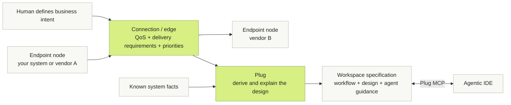
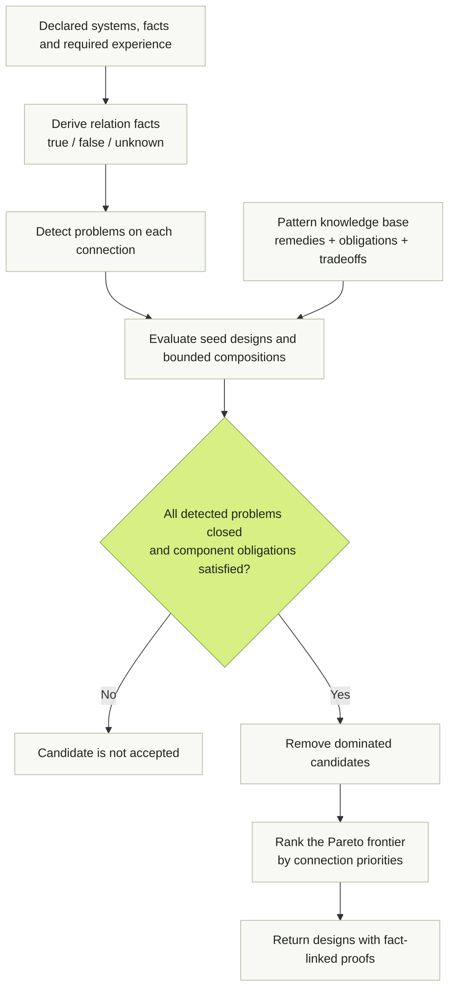
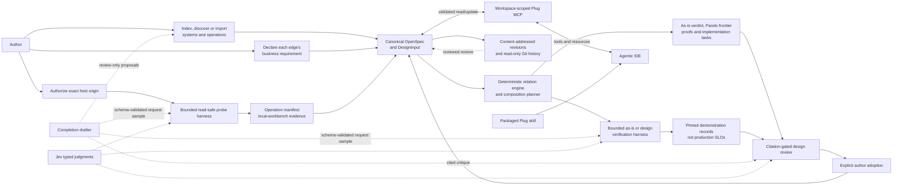
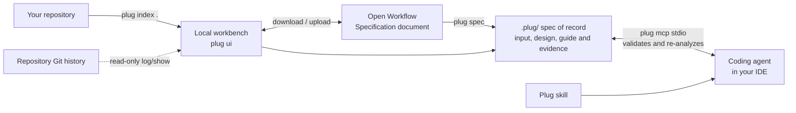

# Plug

**Define the business requirements. Connect vendor endpoints. Keep your coding agent connected to the design.**

Plug lets you model a workflow as a graph of operations from your own systems and
different vendors. Endpoints are nodes; connections are edges with their own
business requirements, quality-of-service targets, and priorities. Define the
response time, freshness, availability, delivery behavior, and tradeoffs the
business needs. Plug uses those requirements and the known system facts to derive
an explainable integration architecture.

The design stays with the project in a workspace spec. Plug exposes it through
MCP so an agentic IDE can read the requirements before changing an integration,
record changes, and re-analyze the result. Generated agent guidance tells the
coding agent how to keep that shared design current.

Plug is a deterministic design engine for the seams between systems — the places
where latency gaps, overload, duplicate side effects and trust boundaries live, and
where most production incidents are born. Describe your systems and connections,
state the operational facts you actually know, declare the experience each
connection must deliver — and Plug composes architectures that close
every detected problem, ranks a Pareto frontier by your priorities, and attaches a
proof to each result. Same input, same design, every time. Analysis makes no model
calls, and your endpoints are never invoked during analysis. Optional local models
have bounded supporting roles: a completion model can draft quote-backed facts,
ephemeral request samples or a cited design critique, while Jev answers registered
typed semantic questions. Code validates every result, and only the author can
adopt it. No model chooses an architecture.



The result is an architecture under your declared facts and assumptions, not a
deployed integration or a measured production guarantee.

## Why

Every "just call their API" hides a design problem:

- A checkout that must respond in milliseconds depends on a supplier that answers
  in fifteen seconds.
- A traffic burst melts a partner's quota, and the retries that follow were never
  safe to repeat.
- An agent invokes an MCP tool twice and a side effect happens twice.
- The design that prevents all of this lives in one engineer's head — and the
  coding agent writing the integration never sees it.

The remedies are decades old: caches, queues, outboxes, circuit breakers,
idempotent consumers. Choosing and combining them is still folklore — senior
engineers pattern-match, everyone else guesses, and language models improvise
confidently. Plug's bet is that, given honest facts and an explicit required
experience, that choice is computable — and therefore reviewable, testable and
explainable. Integration architecture should be derived, not guessed.

## Problems Plug detects — and designs away

For every connection Plug derives three-valued relation facts (true, false or
unknown — unknown facts stay unknown, never defaulted) and checks each one:

| Detected problem         | The question it answers                                  |
| ------------------------ | -------------------------------------------------------- |
| `protocol_mismatch`      | Can the caller natively call the exposed interface?      |
| `contract_mismatch`      | Do the mappings cover the structured contracts?          |
| `first_response_gap`     | Does the live path fit the first-response budget?        |
| `capacity_overload`      | Does sustained request rate exceed the downstream quota? |
| `burst_overload`         | Do bursts exceed the downstream quota?                   |
| `availability_shortfall` | Is downstream availability below the target?             |
| `duplicate_effect`       | Can redelivery repeat a forbidden side effect?           |
| `atomic_publish`         | Must local state and a lossless message change together? |
| `ordering_gap`           | Can the channel preserve the required order?             |
| `trust_boundary`         | Does the connection cross a trust boundary?              |

A candidate architecture is accepted only if it closes every detected problem and
discharges every obligation its own components introduce: a retry must answer
duplication, every remote attempt needs a hard deadline, and requests rejected
above a limit are an explicit, acknowledged loss — never a silent one.

## How a design is derived

Six seed designs — direct, cache-aside, scheduled refresh/prefetch, progressive
response and two compositions — are evaluated against your facts. A pattern
knowledge base (17 pairwise patterns, from timeout, retry with backoff and jitter
and circuit breaker through queue-based load leveling, transactional outbox,
idempotent consumer and dead-letter channel, plus 5 global patterns) feeds a
bounded composition planner. Dominated candidates fall away, the Pareto frontier
is ranked by the priorities you set per connection, and each surviving
architecture carries a proof naming the facts it used. All of it is
deterministic: no model, no randomness, no network calls to your systems.



An unknown fact is not a passing check. Proofs retain the facts and assumptions
used, so reviewers can see what a candidate does and does not establish.

## End-to-end architecture



These outputs have deliberately different authority. Probes establish bounded
facts from one authorized workbench vantage. The engine alone decides feasibility
and composes designs. Verification records what happened in a bounded trial.
The critic and Jev qualify a review, and the author may adopt only an
engine-admissible architecture. Every later analysis re-verifies that adoption
against the current facts and catalog.

## From a graph in your browser to the agent in your IDE

```sh
npx plug ui            # local workbench at http://127.0.0.1:4319, loopback only
npx plug index . --out workspace-index.json
```

1. **Start from your code, not a blank form.** The workbench offers to index the
   current project: a bounded local scan of OpenAPI documents, Agent Cards,
   package manifests and source markers that drafts your system and lists the
   operational facts Plug still needs. It skips secrets, dependencies and
   symbolic links, and the draft is used only after you review and adopt it.
2. **Add and inspect the systems you talk to — index first.** A fresh system starts at its
   URL: enter it and the workbench lists its tools (MCP 2025-11-25), skills
   (A2A 1.0) or operations (OpenAPI) without calling them, noting its own fetch
   time as a synthetic observation. Request headers are used once and never
   saved. Before adding a host, the local workbench discloses that Plug may inspect
   every exposed integration point. Choose **Add and inspect** to run bounded,
   protocol-safe reads and create a timestamped operation manifest, or add without
   inspecting. HTTP `GET`/`HEAD`, MCP `tools/list` and A2A Agent Card retrieval are
   intrinsically read-safe. Any other exact operation requires the author to
   declare both read effect and idempotency; an explicit write is never probed.
   If an eligible request needs values but has no declared example, one configured
   completion call may propose an ephemeral sample. Plug validates it against the
   input schema and every template placeholder, never sends the endpoint or
   credentials to the model, and never writes the sample into the spec. Pasting
   JSON/YAML or raw metadata still works, and the edge inspector lists the facts
   each connection still needs.
3. **Draw the experience you need.** The design is a workflow graph: systems are
   groups, operations are nodes, and every edge is a connection carrying its own
   required experience and priority order. Hover an operation and drag its **+**
   onto another to connect them; create, re-parent, rename, rewire or remove
   anything at any level — fullscreen if you like — and undo restores it.
   Large workflows gain searchable connections and designs grouped by system.
4. **Exchange it as a standard.** Download or upload the graph as an
   [Open Workflow Specification](https://open-workflow-specification.org/)
   document instead of locking intent into a proprietary format.
5. **Hand it to your coding agent — and keep it honest.**

   ```sh
   npx plug spec input.json             # writes .plug/: workflow.yaml, design-input.json, design.json, design.md, AGENTS.md
   npx plug mcp install --ide cursor    # or vscode, claude, generic
   ```

   The agent reads the spec of record and updates it through the `plug mcp`
   stdio server. Its eleven tools cover spec read/update, analysis and explanation,
   indexing, add-and-inspect, probing, edge verification, design review and
   adoption, and retained revision history. Spec, manifest and verification
   resources expose the canonical state and its evidence. Every change is validated and
   re-analyzed. The same workflow is available as the packaged Plug skill for
   agentic IDEs.



The `.plug/` state includes the canonical workflow and generated design bundle,
exact-origin authorizations, bounded probe logs and the latest manifest,
verification and review JSONL records, plus at most 50 content-addressed workflow
revisions. The workbench can review a retained Plug revision or a read-only Git
version before replacing and writing the current workflow. Plug never adds or
commits files to Git.

MCP registration makes the design available to the IDE. The generated
`.plug/AGENTS.md` carries instructions to read it before integration changes and
update it afterward. Reference that guidance from the project instructions your
agent actually loads. Plug registers MCP, installs the skill and generates agent
guidance; it does not enforce every code change.

The full CLI is `plug analyze|explain|demo|setup|index|probe|verify|ui|spec|mcp`,
plus `plug mcp install` and `plug skill install --ide cursor|vscode|claude|generic`.

## Run it locally

Use Node 24 (`nvm use`), then:

```sh
npm ci
npm run dev    # http://localhost:3000, stays running until Ctrl-C
```

The workbench is the first screen. The flight example uses a real 15-second HTTP
source: scheduled caching can serve eligible indicative options quickly while the
source remains slow, with a 60-second refresh inside a bounded 120-second
session. No booking or payment execution is included.

```sh
npm run check
npm run build
npm run test:browser   # npx playwright install chromium, once
npm start              # production UI and API on port 3000 or $PORT
```

## Environment configuration

Plug's deterministic core — indexing/import, analysis, explanation, OpenSpec,
spec history and read-only MCP operations — requires **no environment
variables**. Credentials are required only when you enable a model-backed role,
execute a binding whose headers reference the environment, or deploy the hosted
playground.

After installing the reference package as a dependency (currently from an
owner-authorized tarball), run its guided post-install setup:

```sh
npx plug setup --workspace .
npx plug setup --check --workspace .   # status only; never prints secret values
```

`plug setup` asks which optional roles to enable, masks API-key input, adds
`.env.local` to `.gitignore` with permission, and writes that file with mode
`0600`. It does not require a provider just to use Plug. The package exports
`promptForPlugEnvironment` for the same terminal flow,
`setupPlugEnvironment` for an application-supplied prompt UI, and
`inspectPlugEnvironment`/`inspectWorkspaceEnvironment` for non-secret readiness
checks. `plug ui`, `plug probe`, `plug verify` and `plug mcp` load the selected
workspace's `.env.local`. Direct SDK calls keep configuration explicit through
their provider or `env` arguments.

The local model roles are conditional:

- **Jev typed judgments and cross-checks:** set `TYPESAFE_API_KEY` and the exact
  `PLUG_JUDGE_MODEL`. `PLUG_JUDGE_PROVIDER=typesafe` makes the selection
  explicit; a TypeSafe key also selects it when no judge provider is named.
- **Fact and request-sample drafting:** set either `ANTHROPIC_API_KEY` or
  `OPENAI_API_KEY`, plus the exact `PLUG_DRAFT_MODEL`.
  `PLUG_DRAFT_PROVIDER=anthropic|openai` is recommended and disambiguates when
  both keys exist.
- **Design critique:** by default review reuses `PLUG_DRAFT_PROVIDER` and
  `PLUG_DRAFT_MODEL`. Set `PLUG_REVIEW_PROVIDER` and `PLUG_REVIEW_MODEL` only
  for a separate critic; its matching Anthropic or OpenAI key is still required.
- **Integration credentials:** a persisted header value such as
  `${env:PARTNER_API_TOKEN}` requires `PARTNER_API_TOKEN` at probe or
  verification time. These names are specific to the imported systems and
  cannot be listed globally. Credential values are never written to `.plug/`.

For a public hosted-playground deployment, set `APP_ORIGIN` to the exact public
HTTPS origin. The platform may supply `PORT` (default `3000`);
`TRUST_PROXY_HOPS` defaults to `0` and must change only after the proxy chain is
verified. `RENDER_GIT_COMMIT` or `RELEASE_COMMIT` adds release metadata to
`/healthz`; neither is needed locally. See the safe, value-free
[`.env.example`](.env.example) and [deployment guide](docs/development/deployment.mdx).
`PLUG_TEST_*`, `PLUG_WORKBENCH_*` and `CI` are test-runner controls, not runtime
setup.

## What Plug refuses to do

The guarantees are the product. Each of these is enforced in code and tests:

- **Never invokes your endpoints during hosted analysis.** Hosted execution binds
  only the bundled synthetic fixture. The local workbench can use explicitly
  authorized HTTP(S), MCP Streamable HTTP and A2A JSON-RPC bindings under its
  read-safety, call, rate, timeout, byte and cancellation bounds.
- **Never guesses facts.** Every fact is declared, measured by a probe you
  authorized, or unknown, and the proofs say so. A local
  model may draft a quote-backed declaration, but only your explicit adoption
  enters the graph.
- **Never confuses a demo or probe with production.** Coverage replay is synthetic,
  specific to each exact policy, and assumes successful bounded calls. A warm-hit
  point estimate or local probe percentile is not a production p95; a few runs do
  not validate an SLO.
- **Never infers cache permission from annotations.** Caching is allowed only
  when you say it is.
- **Never weakens your requirements to make a design pass.**
- **Never guesses that two texts mean the same thing.** Semantic equivalence
  passes on exact equality or on a recorded, author-initiated model judgment
  pinned to the exact judged strings (`judged` evidence, local workbench only);
  a stale or missing judgment falls back to the strict comparison.

## Scope today

Manual JSON/YAML, MCP `tools/list` and A2A Agent Cards are supported for metadata
intake; imports preserve unknown metadata and schema dialects. The serialized graph
has no fixed system, operation or connection count ceiling; parsing, requests,
execution and retained history remain byte-, time- and resource-bounded. Schemas,
mappings, QoS, scope and cache permission may still need author input. With
configured completion and TypeSafe providers, the local workbench can draft an
output meaning, mechanically verified mappings or an explicitly documented
per-minute quota; every proposal requires an exact source quote and author
adoption. A bounded critic can review a scrubbed design shortlist with
mechanically resolved citations; Jev cross-checks the concerns and alternatives,
and an unavailable or unsettled judgment never becomes a fact. Composed
architectures are design output; supported seed designs can run against an
explicitly authorized HTTP binding or HTTP-carried MCP/A2A binding when the exact
operation is read-safe. MCP runs include bounded initialization, notification and
session cleanup. Global patterns (backend for frontend, message bus and similar)
are reported as needing global context. No durable cache, distributed scheduler,
restart recovery, OAuth sign-in for discovery or arbitrary expression evaluation.
Model-assisted intake does not infer operational measurements, workload, trust,
cache permission or architectures.

**Release status:** no public deployment or public URL has been verified.
Plug is licensed under the [MIT License](LICENSE). npm publication remains
disabled. See [release notes](RELEASE_NOTES.md).

## Contributing

Plug is young, the spec is a draft, and the interesting problems are open:

- **Grow the knowledge base.** Every pattern is data — the problems it closes,
  the obligations it introduces, contraindications and tradeoffs — in the
  [canonical contracts](schema/draft/schema.ts).
- **Widen intake.** New importers, richer workspace indexing and deeper MCP/A2A
  discovery live in the [reference package](packages/plug/src/index.ts).
- **Sharpen the workbench.** The graph editor, inspector and proof rendering
  live in [apps/playground](apps/playground).
- **Challenge the contract.** Major behavior, contract or process changes go
  through [SEPs](seps/README.md). Current drafts:
  [public alpha design](seps/0000-public-alpha-design.md),
  [local workbench and multi-system inference](seps/0000-local-workbench-and-multi-system.md),
  [workflow graph and OpenSpec](seps/0000-workflow-graph-and-openspec.md),
  [local MCP and A2A discovery](seps/0000-local-mcp-a2a-discovery.md),
  [integration probing](seps/0000-integration-probing-and-measured-facts.md),
  [edge verification](seps/0000-edge-verification-harness.md),
  [design review and adoption](seps/0000-design-review-and-author-adoption.md),
  [OpenSpec revisions](seps/0000-openspec-revision-history-and-git-restore.md), and
  [agent exposure](seps/0000-agent-exposure-mcp-and-skill.md).

Read [CONTRIBUTING.md](CONTRIBUTING.md) first. `npm run check`, `npm run build`
and `npm run test:browser` keep you honest. Until npm publication opens,
[issues and ideas](https://github.com/plugproject/plug/issues) are the best entry
point.

## Learn more

- [Quickstart and custom HTTP adoption](docs/docs/quickstart.mdx)
- [Current draft specification](docs/specification/draft/index.mdx)
- [Architecture and runtime boundaries](docs/specification/draft/architecture.mdx)
- [Canonical contracts](schema/draft/schema.ts) / [reference package](packages/plug/src/index.ts)
- [Deployment](docs/development/deployment.mdx)
- [Implementation status](IMPLEMENTATION.md)

The repository adapts the specification/schema/docs/SEP organization of
[modelcontextprotocol/modelcontextprotocol](https://github.com/modelcontextprotocol/modelcontextprotocol).
It does not inherit that project's governance, ownership or approvals.
