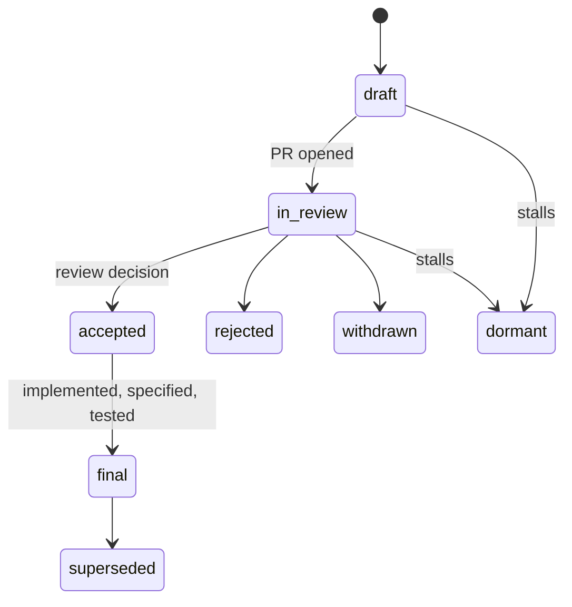
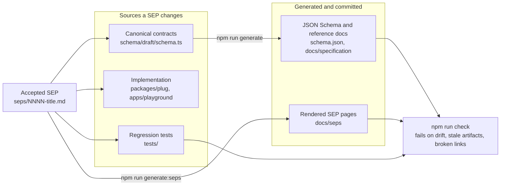

# Plug Specification Enhancement Proposals (SEPs)

> Big changes deserve a paper trail. SEPs are how Plug's contract, behavior,
> and process evolve — deliberately, reviewably, and on the record.

Plug's guarantees are the product: analysis never invokes your endpoints,
unknown facts stay unknown, and every recommended architecture carries a proof.
Changing any of that changes what users can trust, so contract, behavior and
process changes are proposed, reviewed and recorded here instead of improvised
in a pull request. The directory reads like a decision log: what changed, why,
what was considered instead, and what it took to make the change real.

## Current proposals

<!-- sep-index:start -->

| SEP  | Proposal                                                                                                                  | Status  |
| ---- | ------------------------------------------------------------------------------------------------------------------------- | ------- |
| 0000 | [Agent exposure through MCP and a portable Agent Skill](0000-agent-exposure-mcp-and-skill.md)                             | `draft` |
| 0000 | [Design review and author adoption](0000-design-review-and-author-adoption.md)                                            | `draft` |
| 0000 | [Edge verification harness](0000-edge-verification-harness.md)                                                            | `draft` |
| 0000 | [Integration probing and measured facts](0000-integration-probing-and-measured-facts.md)                                  | `draft` |
| 0000 | [Typed judgments for semantic equivalence and index-first intake](0000-judged-semantics-and-index-first-intake.md)        | `draft` |
| 0000 | [Local discovery of MCP tools and A2A skills](0000-local-mcp-a2a-discovery.md)                                            | `draft` |
| 0000 | [Local workbench, workspace indexing and multi-system pattern inference](0000-local-workbench-and-multi-system.md)        | `draft` |
| 0000 | [Quote-gated, author-adopted fact drafting](0000-model-assisted-intake.md)                                                | `draft` |
| 0000 | [OpenAPI intake and complete fact editing in the workbench](0000-openapi-intake-and-fact-editing.md)                      | `draft` |
| 0000 | [OpenSpec revision history and read-only Git restore](0000-openspec-revision-history-and-git-restore.md)                  | `draft` |
| 0000 | [Public alpha system-design recommendations](0000-public-alpha-design.md)                                                 | `draft` |
| 0000 | [Workflow graph editor, Open Workflow Specification interchange and IDE integration](0000-workflow-graph-and-openspec.md) | `draft` |

<!-- sep-index:end -->

The index mirrors each proposal's frontmatter; `0000` means the proposal has
not yet been renamed to its PR number. Whenever a SEP is added, renamed,
retitled or changes status, rebuild the index — [AGENTS.md](AGENTS.md) and the
`update-seps-readme` skill describe the procedure, and `npm run check:docs`
fails on index links that no longer resolve.

## Do you need a SEP?

| Change                          | Route       |
| ------------------------------- | ----------- |
| New contract or behavior change | **SEP**     |
| Process change                  | **SEP**     |
| Bug fix or clarification        | Ordinary PR |

## Writing one

1. Copy [template.md](template.md) into this directory.
2. Start the filename with `0000` (e.g. `0000-my-proposal.md`).
3. Add the proposal to the [index above](#current-proposals).
4. Open a PR, then rename the file to the actual proposal PR number.

**Never invent a PR number, sponsor, or approval.** Owner/actual maintainers
review on GitHub.

## Lifecycle



| Status       | Meaning                                                      |
| ------------ | ------------------------------------------------------------ |
| `draft`      | Being written; not yet under review                          |
| `in-review`  | PR open, awaiting a review decision                          |
| `accepted`   | Review decision recorded                                     |
| `final`      | Implemented, with specification updates and regression tests |
| `rejected`   | Declined after review                                        |
| `withdrawn`  | Pulled by the author                                         |
| `superseded` | Replaced by a later SEP                                      |
| `dormant`    | Inactive; may be revived                                     |

## Where an accepted SEP lands

Acceptance records a review decision only. **Final** means the repository
agrees with the proposal: canonical contracts, generated artifacts, the
implementation and regression tests all tell the same story, and CI fails on
drift between them.



## Tooling

```sh
npm run generate:seps   # render SEP pages into docs/seps (committed)
npm run check:docs      # SEP metadata and sections; doc titles, navigation and links
```

Generated SEP pages are committed: regenerate them whenever a proposal changes,
then run the checks.
