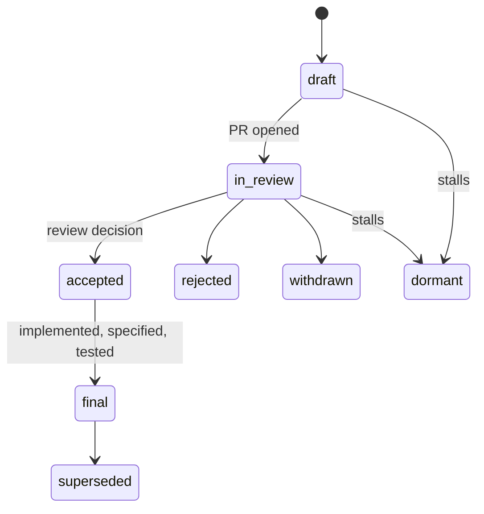

# Plug Specification Enhancement Proposals (SEPs)

> Big changes deserve a paper trail. SEPs are how Plug's contract, behavior,
> and process evolve — deliberately, reviewably, and on the record.

## Do you need a SEP?

| Change                          | Route       |
| ------------------------------- | ----------- |
| New contract or behavior change | **SEP**     |
| Process change                  | **SEP**     |
| Bug fix or clarification        | Ordinary PR |

## Writing one

1. Copy [template.md](template.md) into this directory.
2. Start the filename with `0000` (e.g. `0000-my-proposal.md`).
3. Open a PR, then rename the file to the actual proposal PR number.

**Never invent a PR number, sponsor, or approval.** Owner/actual maintainers
review on GitHub.

## Lifecycle



| Status       | Meaning                                                      |
| ------------ | ------------------------------------------------------------ |
| `draft`      | Being written; not yet under review                          |
| `in-review`  | PR open, awaiting a review decision                          |
| `accepted`   | Review decision recorded                                     |
| `final`      | Implemented, with specification updates and regression tests |
| `rejected`   | Declined after review                                        |
| `withdrawn`  | Pulled by the author                                         |
| `superseded` | Replaced by a later SEP                                      |
| `dormant`    | Inactive; may be revived                                     |

Acceptance records a review decision only. **Final** behavior changes
additionally require implementation, specification updates, and relevant
regression tests.

## Tooling

```sh
npm run generate:seps   # render SEP pages
npm run check:docs      # validate
```
